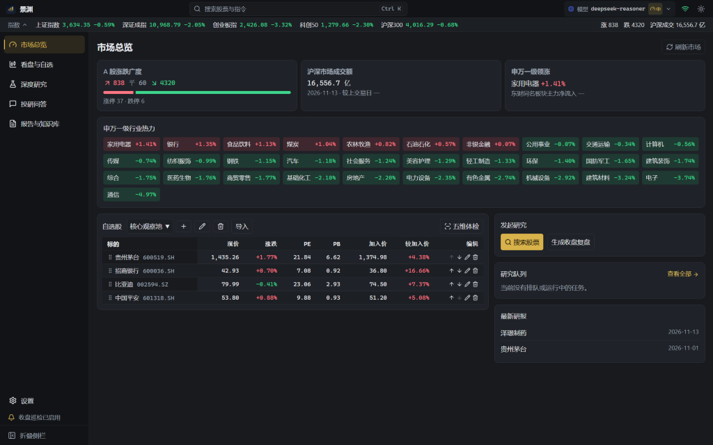
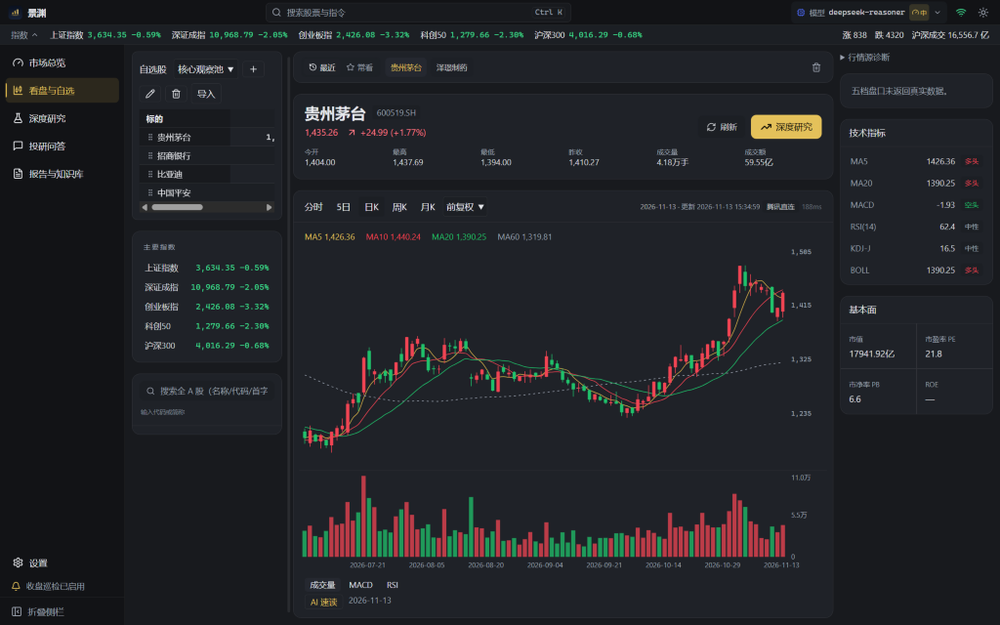
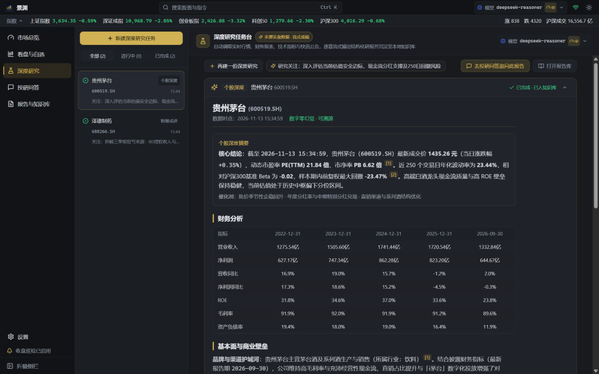
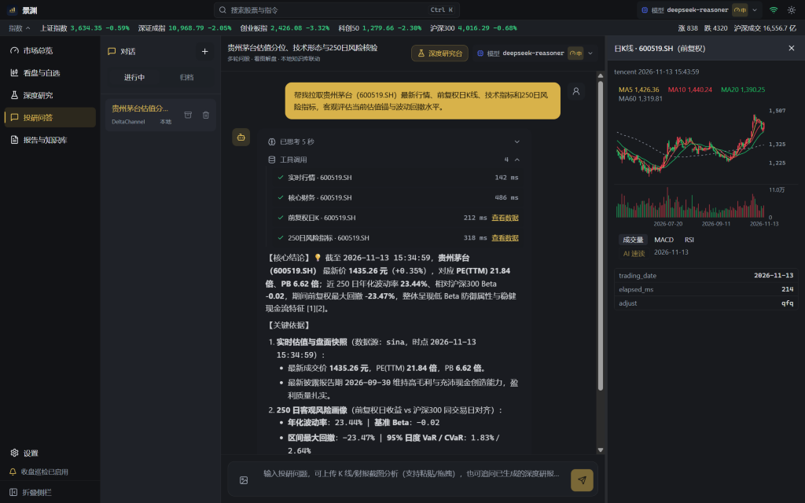
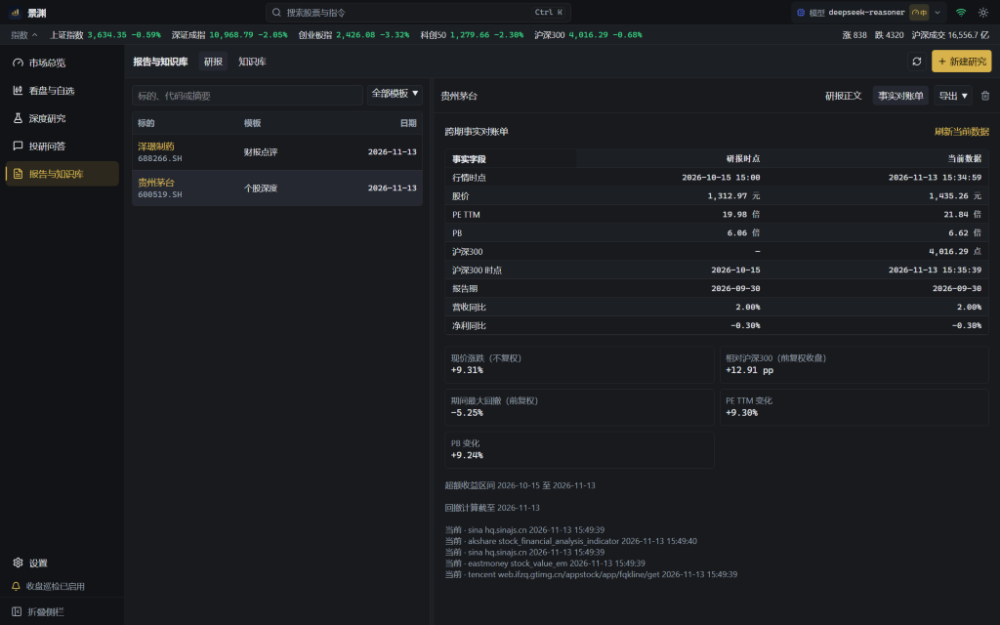
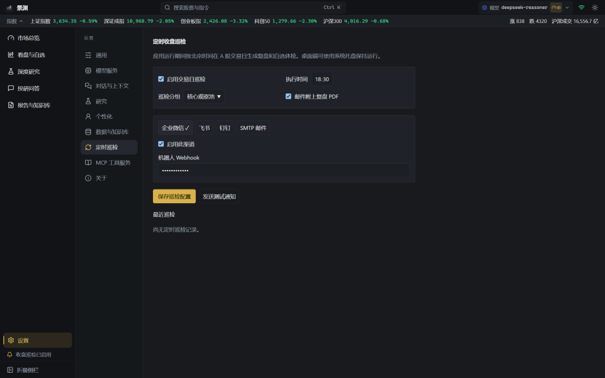

<div align="center">


# 景渊 JingYuan

**A local-first & self-hostable A-share AI research workbench for individual investors.**

[](https://github.com/lryoooow/Financial-AI-Agent-Platform-/releases/latest)
[](https://github.com/lryoooow/Financial-AI-Agent-Platform-/releases/latest)
[](backend/tests)
[](LICENSE)

[简体中文](README.md) · **English**

</div>

---

## v2.0.0 Official Release (GA)

**`v2.0.0` is the first architecture-level General Availability release of JingYuan.** It delivers an Astryx-inspired 6-workspace financial research terminal, a 10-module decoupled agent engine (`engine/` ACL boundary + pure Python `core/`), and three ready-to-use open distributions (**Self-Hosted Web / Docker**, **Windows & macOS Desktop Installers**, and **Ready-to-Run Portable Archives**), verified by **365 automated backend regression tests**.

## Three Iron Product Laws

1. **Zero Number Hallucination** — Every quote, financial indicator, valuation multiple, and risk metric comes strictly from deterministic tools; `NumberEvidence` verifies generated numbers against retrieved facts across turns (with period, unit, and loss-sign grounding), rendering missing fields explicitly as `—`.
2. **End-to-End Provenance** — Tool calls record source, endpoint, and timestamp (`as_of` / reporting period); external documents and news are isolated inside `<untrusted_external_data>` fences and checked via character-level citation verification (`verify_citation`).
3. **Research Only, Never Stock Recommendations** — Dual-track streaming compliance guardrails inspect both visible tokens and reasoning chains (`<think>` / `reasoning_content`) to block buy/sell advice and target prices in real time.

---

## Workbench Tour & Screenshots

### 1. Overview Dashboard
Real-time index ticker tape, market breadth bar (advancers / decliners / limit-up & limit-down),沪深 turnover, Shenwan Level-1 industry heatmap with net capital flow, watchlist snapshot, and `Ctrl+K` (`⌘K`) global command palette.



### 2. Market Terminal, Watchlist & 5D Fact Radar
Intraday, 5-day intraday, and daily/weekly/monthly K-lines (`qfq` / `hfq` / unadjusted) with Volume, A-share `2 × (DIF − DEA)` MACD, Wilder RSI(14), 5-level order book, click-to-explain AI chart read, multi-group persistent watchlists, OCR/CSV/text import preview, and 5-dimensional deterministic fact radar.



### 3. Deep Research Hub
Dedicated workspace supporting 5 templates (*Equity Deep Dive*, *Industry Research*, *Earnings Review*, *Risk Assessment*, and *Post-Close Review*), single-stream continuous section generation, 250-day `qfq` HS300-aligned risk metrics, layered provenance, and flicker-free SSE atomic replay.



### 4. Agentic Research Chat & Artifact Drawer
Multi-turn research Q&A with parallel tool bursts, canonical symbol deduplication, HITL ambiguity confirmation, screenshot paste analysis, collapsible reasoning chain, and interactive right-hand **Artifact Drawer** for K-lines, risk tables, and financial statements.



### 5. Reports Library, Fact Ledger & Hybrid Knowledge Base
Cross-period **Report Ledger** comparing report-date snapshots against live prices, valuations, excess return vs. CSI 300, and max drawdown; exports to **Word / PDF / HTML / Markdown / TXT** plus high-DPI WeChat share posters; subprocess-isolated **SQLite FTS5 + Vector RRF** hybrid RAG (optional PostgreSQL `pgvector`).



### 6. Model Gateway & Post-Close Scheduler
OpenAI-compatible provider gateway (DeepSeek, Qwen, OpenAI, Gemini, GLM, custom relays) with reasoning effort controls (`default / low / medium / high`) and automated trading-day post-close push notifications via WeCom, Feishu, DingTalk, or SMTP email.



---

## Three Ways to Run JingYuan v2.0.0

Download prebuilt packages from [GitHub Releases](https://github.com/lryoooow/Financial-AI-Agent-Platform-/releases/latest):

### 1. Ready-to-Run Portable Archives (No Installation Required)
- **Windows Portable ZIP**: `JingYuan-2.0.0-win-x64-portable.zip` — extract anywhere and launch `JingYuan.exe` (stores data in `./portable-data`).
- **Windows Single-File Portable**: `JingYuan-Portable-2.0.0.exe` — double-click to run directly.
- **macOS Portable ZIP**: `JingYuan-2.0.0-mac-arm64-portable.zip` (Apple Silicon) / `JingYuan-2.0.0-mac-x64-portable.zip` (Intel).

### 2. Desktop Installers (Windows & macOS)
- **Windows x64 Installer**: `JingYuan-Setup-2.0.0.exe` (retains existing `%APPDATA%\FinResearch` data across upgrades).
- **macOS Disk Images**: `JingYuan-2.0.0-mac-arm64.dmg` / `JingYuan-2.0.0-mac-x64.dmg` (`~/Library/Application Support/FinResearch`).

### 3. CLI Startup & Self-Hosted Web Edition

#### Option A — Docker Compose (Recommended for Server / NAS)
```bash
git clone https://github.com/lryoooow/Financial-AI-Agent-Platform-.git
cd Financial-AI-Agent-Platform-
cp .env.example .env
# Edit .env and set FIN_ACCESS_TOKEN when exposed beyond localhost
docker compose up -d --build
```
Open `http://127.0.0.1:9527` (or pull `ghcr.io/lryoooow/jingyuan-web:v2.0.0`).

#### Option B — Native Web Startup Script (Windows / macOS / Linux)
Requires **Node.js 22+**, **pnpm 10+**, and **uv** (Python 3.13):
```powershell
# Windows PowerShell
pwsh -File scripts/start_web.ps1
# Custom port / bind address:
pwsh -File scripts/start_web.ps1 -Port 9528 -BindAddress 127.0.0.1
```
```bash
# macOS / Linux
sh scripts/start_web.sh
```

#### Option C — Split Frontend/Backend Development Mode
```bash
# Terminal 1: FastAPI hot-reload backend on :8000
uv sync --project backend --locked --extra dev --python 3.13
FIN_DEV=1 FIN_DOCS=1 uv run --project backend --locked uvicorn finresearch.main:app --reload --host 127.0.0.1 --port 8000

# Terminal 2: Vite dev server on :5173
pnpm --dir fronted install --frozen-lockfile
VITE_API_BASE=http://127.0.0.1:8000 pnpm --dir fronted dev
```

#### Option D — Tests & Desktop Packaging from Source
```bash
uv run --project backend --locked --extra dev python -m pytest -q backend/tests
pnpm --dir fronted typecheck
# Windows desktop bundle (.exe installer + portable .exe + portable .zip):
.\build_release.bat
```

---

## Data Privacy, Disclaimer & License

- **Local-First Storage & Secret Encryption**: Data stays on your machine or self-hosted volume by default (`FINRESEARCH_DATA_DIR` to customize). Secrets are encrypted at rest via Windows DPAPI or persistent Fernet keys and masked across APIs and logs.
- **Disclaimer**: JingYuan is a financial research aid. It does not provide investment advice, does not connect to any broker, and cannot place orders. **Every investment decision and its consequences are solely yours.**
- **License**: Free for **personal, non-commercial use**. Commercial use, redistribution, and reverse engineering are prohibited. See [LICENSE](LICENSE) and [CHANGELOG](CHANGELOG.md).

---

<div align="center">
<sub>景渊 JingYuan v2.0.0 · Built for research, not for trading.</sub>
</div>
